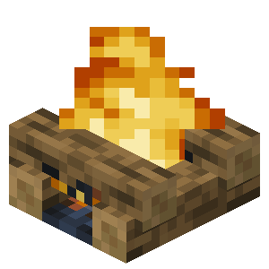
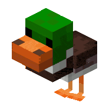

 

 
 

Меня зовут <b>Иван</b> — web-разработчик. 
Люблю минимализм, чистый код и тёплые вечера у костра.

 

<table align="center">
  <tr><td align="right">💻</td><td align="left">&nbsp;WEB-разработка на <b>React</b> и <b>TS</b></td></tr>
  <tr><td align="right">⚙️</td><td align="left">&nbsp;Есть свой игровой сервер <b>Minecraft</b></td></tr>
  <tr><td align="right">🧮</td><td align="left">&nbsp;Люблю решать <b>code-задачки</b></td></tr>
  <tr><td align="right">🤖</td><td align="left">&nbsp;Не стесняюсь обращаться к <b>LLM</b></td></tr>
</table>

 

---

 

<h3>🛠️ Технологии</h3>

<b>Frontend</b> 

 

<b>Backend</b> 

 

<b>Инструменты</b> 

 
 

---

 

<h3>📊 Статистика</h3>

 

 
 

Сделано с 🔥 и капелькой Minecraft-души

